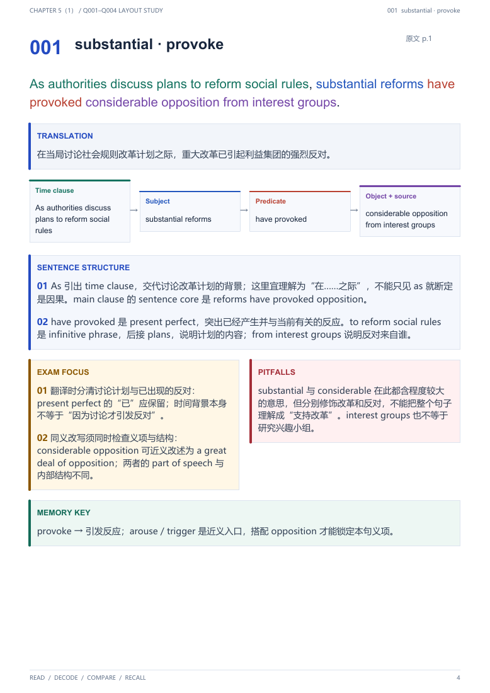

# English Atlas｜英語精讀圖譜

An agent-independent skill for turning English sentence exercises into detailed bilingual study atlases: printable, searchable PDF and a self-contained offline HTML edition.

将编号式英语句子练习 PDF、图片或文档制作成完整精读图谱。保留原句、自然译文与详细解析，以拆句图、独立词卡、逐项近义辨析和考点面板帮助学习。正文 Grammar 术语使用 English，并集中提供中英术语表及真实例句跳转。



正式 Skill ID、安装文件夹和调用名称统一为 **`english-atlas`**。核心指令位于 [SKILL.md](SKILL.md)，遵循可移植的 Agent Skills 目录形式；Python 工具可在宿主之外独立运行。

## 安装到不同 Agent

[下载完整 ZIP](https://github.com/hyperactification/english-atlas/archive/refs/heads/main.zip) 或克隆仓库：

```sh
git clone https://github.com/hyperactification/english-atlas.git english-atlas
```

保留完整目录，确保 `english-atlas/SKILL.md` 与 `scripts/`、`references/`、`assets/` 位于同一级。

| 使用环境 | 安装或加载方式 | 调用方式 |
| --- | --- | --- |
| Claude Code | 放入个人 `~/.claude/skills/english-atlas/`，或项目 `.claude/skills/english-atlas/`。 | `/english-atlas` 或自然语言。 |
| Codex | 放入当前客户端配置的 skills 目录，子目录名为 `english-atlas`；本项目现有安装位置为 `~/.codex/skills/english-atlas/`，设置了 `CODEX_HOME` 时使用其 `skills/` 子目录。 | `$english-atlas` 或自然语言。 |
| 其他支持 Agent Skills 的 Agent／IDE | 使用其导入功能，或放入该宿主实际支持的 skills 目录。 | 按宿主的技能选择或命令规则调用。 |
| 可读文件并执行工具的通用 Agent | 告知完整目录位置，要求先读取 `SKILL.md`，再按相对路径读取参考资料并运行工具。 | 自然语言即可。 |

`agents/openai.yaml` 仅是可选的客户端显示配置；其他宿主可以忽略。核心流程不依赖专有连接器、宿主缓存路径或特定命令前缀。只有文档读取能力的环境可用于分析与撰写，PDF／HTML 文件生成和验收需要可执行脚本或等效文档工具的环境。

以上路径是安装示例，实际发现规则和工具权限以宿主版本为准。本项目已在 Windows 上运行验证；macOS／Linux 提供通用 Python 入口与字体发现逻辑，尚未在原生系统上完成实测。

## 使用

```text
使用 English Atlas，把附件全部句子制作成精读图谱，完整翻译和详细讲解，突出词条、近义辨析及考点，输出 PDF 和离线互动版。
```

每题保留原题号、来源页码和完整英文，提供自然译文、Sentence structure、Vocabulary、Exam focus、Pitfalls、拆句图和记忆提示；原文问题独立列为 Source note。Near synonyms 贴合本句义项，并说明语气、程度、词性或结构差别与替换限制；没有合适表达时说明原因。

排版按内容调整：原句、译文和拆句图先行；结构、考试提示与词汇分区呈现。共同检查首页与续页的密度，优先在完整面板和词卡之间重新分配内容。长词卡续页保留词条头，每题续页保留题号和关键词。HTML 支持全文／题号搜索、译文自测、单句揭晓、重置、章节导航与 Grammar Glossary 例句跳转，可直接离线打开。

## 独立运行

需要 Python 3.10+。在 Skill 根目录安装 Python 依赖并检查环境：

```sh
python -m pip install -r requirements.txt
python scripts/run.py doctor
```

按环境使用 `python3` 或解释器的实际路径。提取源材料、人工／Agent 撰写完整的 `notes.json` 后，依次校验、渲染并检查：

```sh
python scripts/run.py extract --input source.pdf --output-dir work/run
python scripts/run.py validate --input work/run/notes.json --source work/run/sentences.json
python scripts/run.py render --input work/run/notes.json --output-dir outputs --qa-dir work/run/qa
python scripts/run.py verify --qa-dir work/run/qa --render
```

提取器不自动翻译或撰写解析。PDF 视觉检查需要 Poppler；自动浏览器检查需要 Node、Playwright 和可用浏览器。字体支持显式指定及系统发现，不要求某一宿主或 Windows 字体。完整依赖、参数和排错见 [runtime.md](references/runtime.md)。

## 目录与数据

```text
english-atlas/
├── SKILL.md
├── README.md
├── requirements.txt
├── agents/openai.yaml          # 可选客户端显示配置
├── assets/                     # 小型示例与版式参考图
├── references/
│   ├── content-guide.md
│   ├── design-guide.md
│   ├── schema.md
│   └── runtime.md
└── scripts/
    ├── run.py                  # 通用 Python 入口
    ├── run.ps1                 # 可选 PowerShell 入口
    ├── extract_sentences.py
    ├── validate_content.py
    ├── render_notes.py
    ├── atlas_layout.py
    ├── lexical_resources.py
    ├── grammar_terms.py
    ├── verify_artifacts.py
    └── check_web.cjs
```

内容结构见 [schema.md](references/schema.md)，教学边界见 [content-guide.md](references/content-guide.md)，视觉与续页验收见 [design-guide.md](references/design-guide.md)。示例 JSON 和参考图用于展示结构与版式，不代表完整教材章节。

仓库不附用户完整源 PDF 或第三方完整学习材料。使用者提供有权使用的材料；本次提取、内容 JSON 和 QA 留在独立工作目录，最终交付 PDF 与离线 HTML。